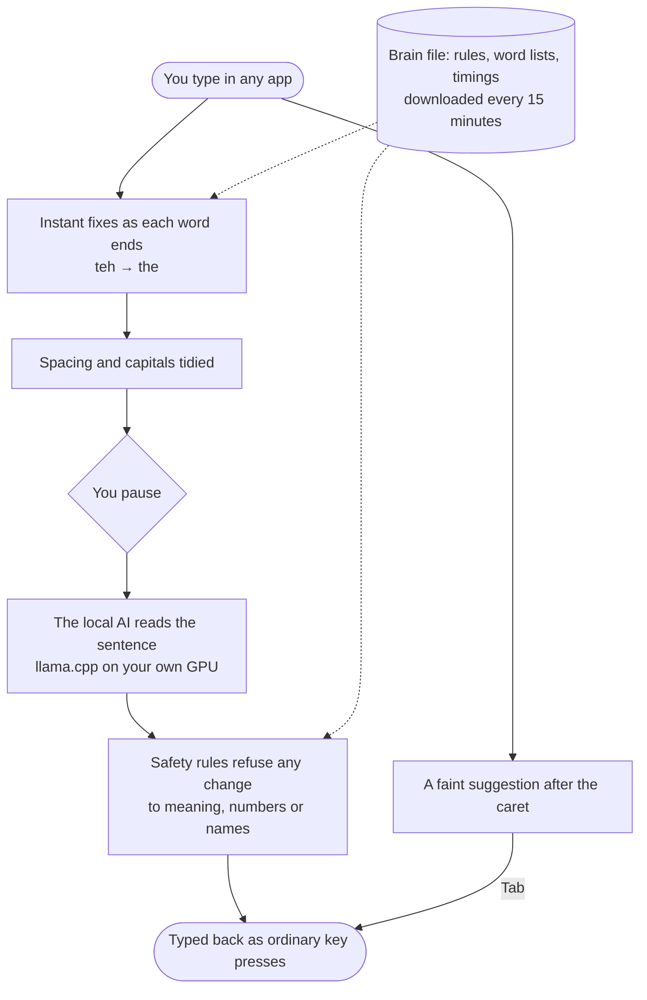
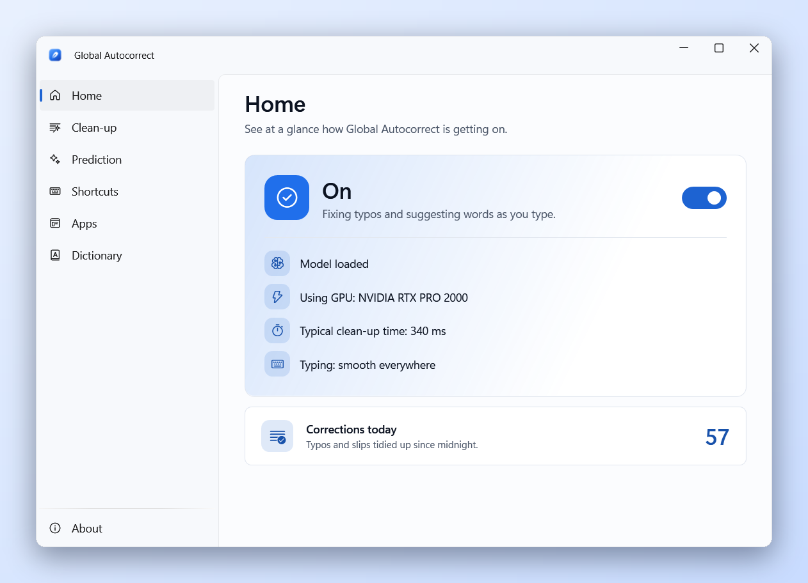
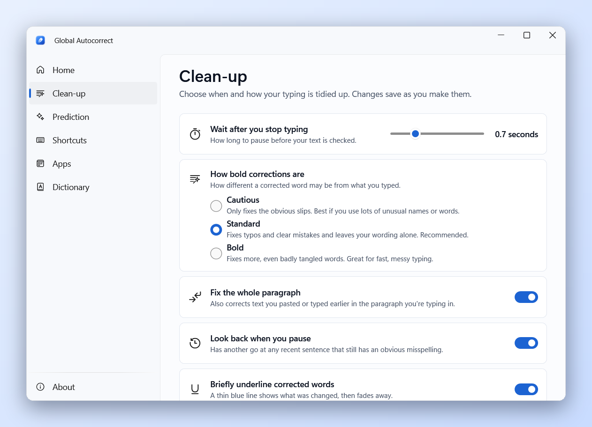
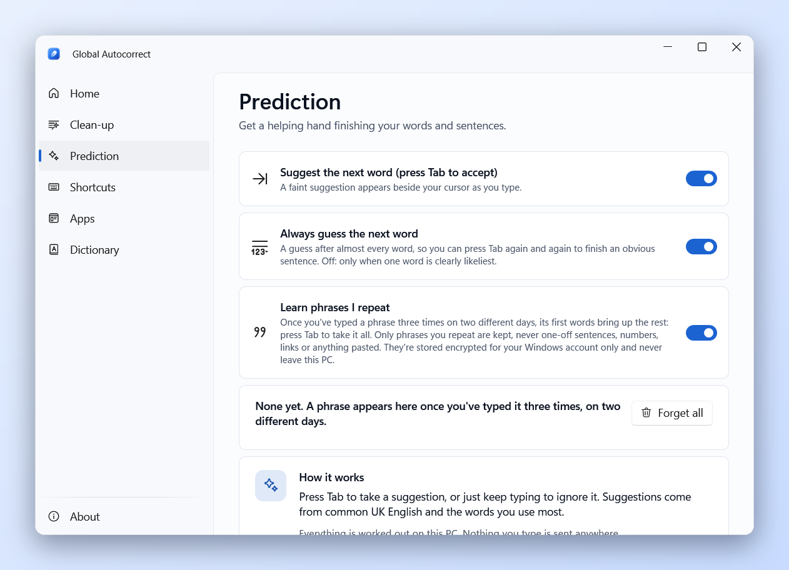
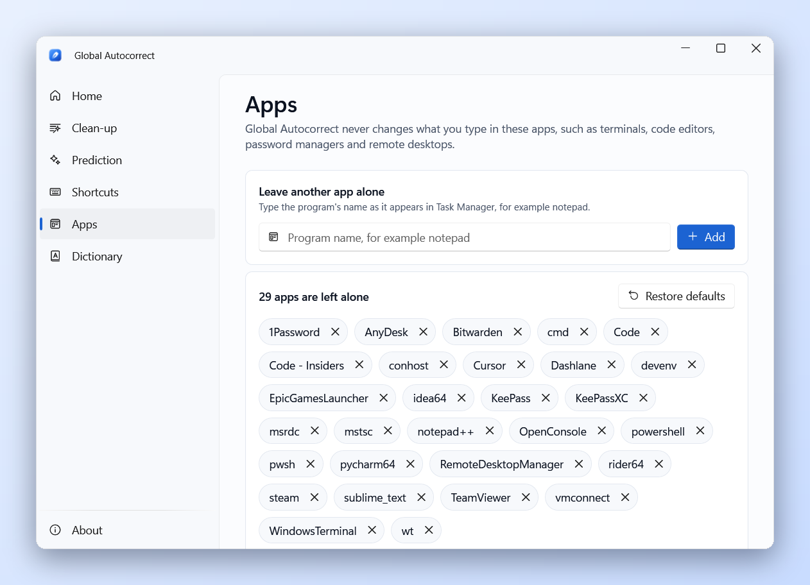
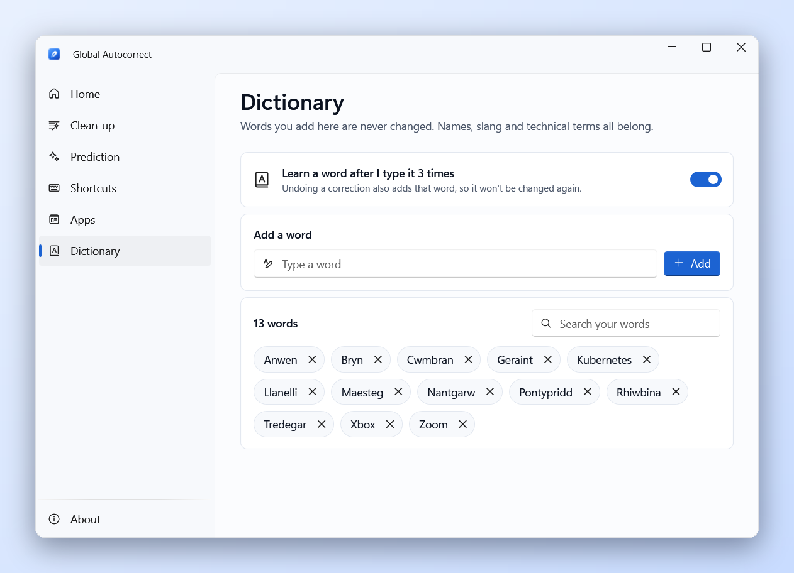
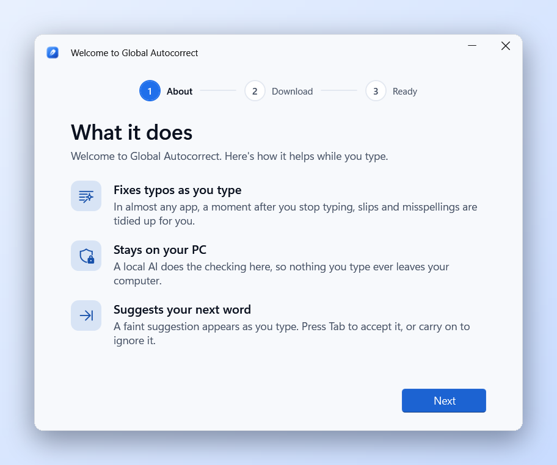

<div align="center">


# Global Autocorrect

### Typo-free typing in every Windows app, from a private AI on your own GPU.

Fixes your slips the moment you make them, tidies each sentence when you pause, and finishes your words with one press of **Tab**.<br>
In Outlook, Teams, Word, your browser and almost anything else you type in. Nothing you type ever leaves your PC.

[](https://github.com/granterogers/global_autocorrect/releases/latest)


<br>

<picture>
  <source media="(prefers-color-scheme: dark)" srcset="docs/images/demo-dark.svg">
  
</picture>

**[Install](#install)** &nbsp;·&nbsp; **[Why it matters](#why-it-matters)** &nbsp;·&nbsp; **[Features](#features)** &nbsp;·&nbsp; **[How it works](#how-it-works)** &nbsp;·&nbsp; **[Screenshots](#screenshots)** &nbsp;·&nbsp; **[Privacy](#privacy-by-construction)** &nbsp;·&nbsp; **[Accuracy](#measured-accuracy-and-speed)**

</div>

<br>

<table>
<tr>
<td align="center" width="20%"><h2>0 bytes</h2>of your typing sent anywhere. The AI runs on your own graphics card.</td>
<td align="center" width="20%"><h2>177 ms</h2>for a typical AI clean-up of a sentence. Spelling slips are fixed instantly.</td>
<td align="center" width="20%"><h2>92.9%</h2>of mistakes fixed on 200 messages it never saw during tuning.</td>
<td align="center" width="20%"><h2>1 in 1,300</h2>correct words wrongly changed. It would rather leave a slip than touch what you meant.</td>
<td align="center" width="20%"><h2>Any app</h2>Word, Notepad, Edge, web editors and forms, Teams and more, with no plug-ins.</td>
</tr>
</table>

## Why it matters

Every typo has a hidden cost. You notice it, stop, reach for Backspace, retype, find your place and pick up the thought you were in the middle of. That's three to five seconds each time, and the interruption costs more than the seconds: it breaks your flow. The rest slip through and land in front of customers, colleagues and your manager.

Global Autocorrect takes that whole loop away. You keep your eyes on your thoughts, not on your typing.

| | Without it | With Global Autocorrect |
|---|---|---|
| A typo like `teh` or `thnaks` | Stop, Backspace, retype, carry on | Fixed the instant you press space |
| A sentence typed fast: `Ill send it over by friday .` | Re-read it, fix three things by hand | Tidied in about a fifth of a second when you pause: `I'll send it over by Friday.` |
| Words you type every day | Every letter, every time | Type the first few letters and press **Tab** |
| Phrases you repeat (`Let me know if you have any questions`) | Typed out in full, again | Learnt after you've typed them a few times; **Tab** finishes them |
| Different spell checkers in every app | Some apps check, most don't | The same help everywhere you type |
| Your text and AI | Pasted into a website, sent to someone's servers | Never leaves the PC |

> **Back of the envelope.** Say it tidies up 60 slips in your working day (the Home page counts yours) and each would have taken 4 seconds to fix by hand. That's **4 minutes a day, or about 15 hours a year**, before counting the words **Tab** types for you, the re-reading you no longer do, or the typos that would otherwise have gone out in an email. Across a team of 50, that's around **750 hours a year** given back.

## Features

<table>
<tr>
<td width="50%" valign="top">

### ⚡ Instant fixes
Obvious slips are fixed the moment you finish a word: `teh` becomes `the`, `bookk` becomes `book`. No AI needed, no waiting.

</td>
<td width="50%" valign="top">

### 🧠 A real AI that reads the sentence
When you pause, a small language model running on your GPU reads the whole sentence and fixes what a dictionary can't: run-together and split words, missing apostrophes and capitals, punctuation and grammar slips.

</td>
</tr>
<tr>
<td valign="top">

### ⇥ Tab to finish your words
A faint suggestion appears after the caret, from everyday UK English and the words and phrases **you** use most, per app. Press **Tab** to take it, or just keep typing.

</td>
<td valign="top">

### ✍️ It fixes mistakes, not your style
It never swaps your words for synonyms, rephrases you or changes British spellings to American ones. Strict safety rules throw out any AI change that alters a number, a name or your meaning.

</td>
</tr>
<tr>
<td valign="top">

### 🧹 Tidy spacing and capitals
`steps .` becomes `steps.`, double spaces become one, `end.Next` becomes `end. Next`, `i` becomes `I`, and a new sentence starts with a capital. Names with dots (`.NET`, `index.html`), emoticons, abbreviations and code are left alone.

</td>
<td valign="top">

### 🔁 Looks back when you pause
When you stop for a moment it checks what you typed recently for anything still obviously misspelt, and has another go at that sentence.

</td>
</tr>
<tr>
<td valign="top">

### 📈 Gets better without updates
The correction rules, word lists, timings and AI instructions live in a small "brain" file that every copy downloads within 15 minutes. Most improvements reach you without a new version at all.

</td>
<td valign="top">

### 🔄 Updates itself, quietly
When a new version is out it installs itself while you're away from the keyboard, or the moment you lock your PC. Every download is checked against its published checksum first.

</td>
</tr>
<tr>
<td valign="top">

### ↩️ One shortcut to undo
Didn't want that change? **Ctrl+Alt+Z** puts it back from anywhere in the field and remembers the word, so it's never changed again. Your own **Ctrl+Z** is left exactly as it was.

</td>
<td valign="top">

### 🛡️ Knows where to stay out
It never touches password boxes, programs running as administrator, terminals, code editors, password managers, remote desktops, games or Excel cells. The list is yours to edit.

</td>
</tr>
</table>

## How it works



- **It reads what you type through Windows' own accessibility interface** (UI Automation), the same one screen readers use, so it works in almost every app without plug-ins.
- **It writes corrections back as ordinary key presses**, exactly as a keyboard would, so every app accepts them and its own undo still works.
- **Your typing is never held up.** Instant fixes happen as each word ends; the AI works in the background and its fix is only typed in if you haven't moved on.
- **The AI is Gemma 4 E4B, running locally in llama.cpp** on an NVIDIA graphics card. It loads when you start typing and frees its memory after 15 idle minutes.

## Screenshots

<table>
<tr>
<td width="50%">
<picture>
  <source media="(prefers-color-scheme: dark)" srcset="docs/images/home-dark.png">
  
</picture>
<p align="center"><b>Home.</b> Everything at a glance, including today's corrections.</p>
</td>
<td width="50%">
<picture>
  <source media="(prefers-color-scheme: dark)" srcset="docs/images/clean-up-dark.png">
  
</picture>
<p align="center"><b>Clean-up.</b> Choose how bold it is and when it steps in.</p>
</td>
</tr>
<tr>
<td>
<picture>
  <source media="(prefers-color-scheme: dark)" srcset="docs/images/prediction-dark.png">
  
</picture>
<p align="center"><b>Prediction.</b> Tab suggestions that learn your phrases.</p>
</td>
<td>
<picture>
  <source media="(prefers-color-scheme: dark)" srcset="docs/images/apps-dark.png">
  
</picture>
<p align="center"><b>Apps.</b> The programs it never types into.</p>
</td>
</tr>
<tr>
<td>
<picture>
  <source media="(prefers-color-scheme: dark)" srcset="docs/images/dictionary-dark.png">
  
</picture>
<p align="center"><b>Dictionary.</b> Names and words it should never change.</p>
</td>
<td>
<picture>
  <source media="(prefers-color-scheme: dark)" srcset="docs/images/firstrun-1-dark.png">
  
</picture>
<p align="center"><b>First run.</b> Three steps and you're typing.</p>
</td>
</tr>
</table>

## Privacy by construction

- **No cloud.** The AI runs on your own graphics card through a local server that only listens on your own PC (127.0.0.1) and needs a key only the app knows.
- **No text is ever logged or saved.** Only counts are kept, such as "corrections today".
- **Suggestions learn from you, on your PC only.** It counts the words you use and short runs of two or three words so your own phrases come up next time, per app (what you write in Teams is preferred in Teams). Never whole sentences, numbers, email addresses, or anything typed in a password box or an excluded app. They stay in `%APPDATA%\GlobalAutocorrect\history.txt`; delete that file to forget them. Phrases you repeat are stored encrypted for your Windows account only, and you can forget them all from the Prediction page.
- **The app only downloads, unless you choose to share.** It downloads the model once when you install, new versions from GitHub and the latest brain file. Nothing about you or your typing is sent.
- **Sharing is your choice, and you can read it first.** Switch on **Share what it learns** (Settings › About) and once a day it sends counts of how fixes went in each program, and one-way codes of changes you undid. Never words, names or anything about your PC. **See exactly what is sent** opens the very file it sends. It's off until you switch it on.
- **Nothing shared reaches anyone's PC unchecked.** Shares go to a small relay that can't change anything. Once a week they are folded into a candidate brain, which must pass the same stress runs and real-model test as a release, and then wait for approval from the person who runs the project. A change only counts once three different installs have undone it, so no single install can stop a fix for everybody.

## Built to be trusted

This isn't a weekend script that types into your apps and hopes for the best.

- **Every release passes three gates** before it's published: end-to-end tests that type into real editors (Notepad, Word-style rich text, Edge, ProseMirror, Lexical, CKEditor, Slate), a stress set of heavily mangled multi-sentence messages, and a real-use run on real messages through the real model that fails on a single "stupid" mistake: a changed name, a wrong capital, a repeated word or an added question mark.
- **Around 600 automated tests**, including layout checks of every window at five display scales, light and dark.
- **Every judgement call is written down**: more than 170 recorded decisions in `DECISIONS.md`, each with the evidence behind it.
- **Accuracy is scored on a held-out set** that was never used for tuning, and the numbers below are what it scored, misses included.

## Install

**You need:** Windows 11, an NVIDIA graphics card (built and measured on an 8 GB RTX PRO 2000; without one it falls back to a smaller model on the CPU) and about 8 GB of free space.

**One command.** Open **Windows PowerShell** from the Start menu, paste this and press Enter:

```powershell
powershell -ExecutionPolicy Bypass -c "irm https://raw.githubusercontent.com/granterogers/global_autocorrect/main/get.ps1 | iex"
```

It checks your PC can run the app, installs PowerShell 7 if it's missing (with `winget`), downloads the latest release, checks it against the checksum published with it and runs its installer. You can read exactly what it does first: [`get.ps1`](get.ps1).

<details>
<summary>Or install by hand</summary>

1. Download `GlobalAutocorrect-<version>.zip` from the **[latest release](https://github.com/granterogers/global_autocorrect/releases/latest)** and unzip it.
2. From the unzipped folder, run (needs PowerShell 7):

```
pwsh -NoProfile -ExecutionPolicy Bypass -File .\install.ps1
```

</details>

Either way, the installer downloads the model and llama.cpp the first time (about 5.5 GB, each file checked against its published fingerprint), installs the app to `%LOCALAPPDATA%\Programs\GlobalAutocorrect` and starts it. It starts with Windows (you can turn that off in Settings) and lives in the system tray. Your settings, dictionary and history in `%APPDATA%\GlobalAutocorrect` are never touched by an install or update.

To check it's using the GPU:

```
pwsh "$env:LOCALAPPDATA\Programs\GlobalAutocorrect\scripts\verify.ps1"
```

Every check prints OK, or explains the fix in plain language.

### Updates

Once an hour it asks GitHub whether a newer version has been released. When there is one, it downloads it, checks it against the checksum published with the release (and refuses if that doesn't match or is missing), and installs it **by itself after 10 minutes away from the keyboard, or as soon as you lock your PC**, so it never interrupts your typing. The app closes, is replaced and starts again in a few seconds. You can also install straight away from **Settings › About**, and turn off **Check for updates** there to stop the checks.

Separately, every running copy downloads the latest brain file within 15 minutes. That's how most correction improvements arrive: no new version, no restart.

## Shortcuts

| What | Default | Change it in |
|---|---|---|
| Pause or resume | **Ctrl+Alt+P**, or one click on the tray icon | Settings › Shortcuts |
| Undo the last correction, from anywhere in that field | **Ctrl+Alt+Z** | Settings › Shortcuts |
| Take the suggestion | **Tab**, only while it's showing | Settings › Prediction (on or off) |

Undoing a correction also adds that word to your personal dictionary, so it won't be corrected again. **Ctrl+Z is left alone:** it always does whatever your app normally does.

## What it doesn't do

- It never touches password fields, windows running as administrator, or the apps on its excluded list: terminals, code editors, password managers, remote desktop, games and Excel cells. You can edit that list.
- It corrects the whole paragraph you're typing in, including text you pasted or dictated into it. Paragraphs you aren't typing in are left alone. Turn off "Fix the whole paragraph" on the Clean-up page, or set "How bold" to **Cautious**, to correct only what you type yourself.
- It keeps no history or list of corrections. Only counts are kept.
- English (UK) only, on a UK keyboard layout.

## Windows Defender

A program that watches the keyboard and types for you can look like a keylogger to antivirus software. If Global Autocorrect disappears after you start it:

1. Open **Windows Security › Virus & threat protection › Protection history**.
2. Choose the Global Autocorrect entry and pick **Allow on device**.
3. Optionally add the app folder under **Virus & threat protection settings › Exclusions › Add an exclusion › Folder**.

`pwsh scripts/verify.ps1` checks for this too.

## Measured accuracy and speed

Measured on 200 test messages that were never used for tuning. These are everyday UK English messages with realistic typing slips added, plus hand-mangled ones. The whole pipeline was scored: instant fixes, the AI and the safety rules together. Measured 30 October 2026 with Gemma 4 E4B on the RTX PRO 2000, after a second round of tuning on the separate tuning set (the same 200 test messages were also scored once before that round, at 92.3%). The full report is `eval-report.md` in the release zip, and every scored run is kept in `docs/metrics`.

| | Result | Target |
|---|---|---|
| Mistakes fixed | **92.9%** | 95% ❌ (not met) |
| Correct words wrongly changed | **0.08%** (about 1 in 1,300) | under 1% ✅ |
| Messages left exactly as intended | 87% | — |
| Time for an AI clean-up | 177 ms typical, 309 ms slowest 5% (held-out set, with lookup decoding, D56) | under 2 s ✅ |

**Where it falls short.** Light slips are fixed 94% of the time and heavily mangled messages 97%. Messages with many different slips at once are fixed 88% of the time. Most misses are:
- a dropped small word the model won't guess ("make stand-up" instead of "make the stand-up");
- a slip that turns one real word into another, or into a name ("dun" became "Dunn" instead of "sun");
- a space typed one letter too early, which splits one word and joins its last letter onto the next.

It prefers leaving a mistake to changing something you meant. That's why wrong changes are so rare.

## Apps tested

| App | How it was tested | Result |
|---|---|---|
| Notepad (Windows 11) | Spike B; end-to-end tests: AI fix, Tab suggestion, works alongside the autocorrect built into Notepad | ✅ (see note) |
| Word | Spike B | ✅ |
| Edge: plain text box | Spike B; end-to-end tests | ✅ (see note) |
| Edge: rich text box | Spike B; end-to-end tests | ✅ (see note) |
| Edge: ProseMirror editor | Spike B; end-to-end tests | ✅ (see note) |
| Edge: Lexical editor | Spike B; end-to-end tests | ✅ (see note) |
| WPF text box | End-to-end tests: instant fix, Ctrl+Alt+Z undo and learning the word, Ctrl+Z left to the app | ✅ (see note) |
| Password boxes | End-to-end test | ✅ never touched |
| Intercom, Claude.ai, ChatGPT in Edge | Not automated: they need your signed-in accounts. Their message boxes are rich web editors like the ones above | ⚠️ Please try: a typo, a "their/there" sentence, Ctrl+Alt+Z after a fix, Tab on a suggestion |
| Outlook (classic) | Spike B could not put the cursor in the message body automatically | ⚠️ Not verified. Its message body is the same editor as Word, which passes |

Since then the end-to-end gate has grown to cover CKEditor and Slate editors as well, and every release must pass it.

## Known limits

- **Accuracy is below the 95% target** (92.9% of mistakes fixed). A bigger model might reach it, but corrections would take about twice as long, so speed was chosen instead (D33). It is weakest on messages with many slips at once, and on a missing small word such as "the", which it rarely puts back.
- **It only works where the app reports its text and cursor position to Windows.** Most apps do. Where an app doesn't, Global Autocorrect does nothing rather than guess.
- **It never corrects across a line break**, and only looks at the current paragraph.
- **Some apps also autocorrect.** If Word, Outlook or Notepad changes a word itself, Global Autocorrect notices and stays out of the way, so it may skip that correction.
- **Code editors are excluded by default.** In VS Code and similar editors, only about a page of text is visible to other apps.
- **Changing the AI model takes effect after a restart.**
- **While the model is loaded it uses about 4 GB of ordinary memory as well as about 4.5 GB of graphics memory.** That's how this model is built (part of it lives in ordinary memory so the rest fits on the graphics card). It unloads itself after 15 minutes without typing (Settings › Clean-up › "Free the AI's memory after": 5, 15, 30 or 60 minutes) and reloads in about 3 seconds. The reload starts as soon as you click or tab into a text box it corrects, or on your first key, so it is often ready before you start typing; nothing reloads while Global Autocorrect is paused. AI corrections due while it reloads are made once it is ready (spelling fixes that don't need the AI carry on as usual), and your typing is never held up.
- **Other GPU-heavy apps can slow clean-ups down.** The model needs about 3.5 GB of the 8 GB of graphics memory. If games, video tools or other AI apps take the rest, Windows quietly moves graphics memory into ordinary memory and clean-ups can take seconds instead of a third of a second. `scripts/verify.ps1` measures this.
- **Ctrl+Alt+Z undoes from anywhere in the field that was corrected**, not from another window. If you've moved to another window, it tells you to switch back.
- **A shortcut can be taken by another app.** If Ctrl+Alt+P or Ctrl+Alt+Z is already in use, the tray tells you and you can choose another in Settings.
- **Corrections are typed as ordinary key presses**, as a keyboard would (D22 in `DECISIONS.md`). Sending raw Unicode characters instead, as first planned, scrambled text in Notepad. Characters with no key on a UK keyboard (such as é) are still sent as Unicode.
- **UK English and a UK keyboard layout only.**

## Requirement coverage
Every requirement in the brief, with the tests that prove it or the recorded check (2.11, 11.2). Generated by `scripts/coverage.ps1`; "Recorded check" items are verified by a script, a review or a measured run, as described.

<details>
<summary><b>Show all requirements and their proof</b></summary>

| ID | Status | Proof |
|---|---|---|
| 0.1 | Recorded check | eval report shows errors fixed / false edits (M6) |
| 0.2 | Tested (incl. E2E) | 5 test(s), e.g. `R0_2_a_RealDictionariesFixTehAndBookk` |
| 0.2.a | Tested (incl. E2E) | 3 test(s), e.g. `R0_2_a_RealDictionariesFixTehAndBookk` |
| 0.2.b | Tested (incl. E2E) | 9 test(s), e.g. `R11_3_a_NotepadAiFix_R0_2_b` |
| 0.2.c | Tested | 1 test(s), e.g. `R0_2_c_AppliesEveryAcceptedEdit` |
| 0.2.d | Tested | 34 test(s), e.g. `R4_4_d_ACapitalAfterASentenceEndTheReplyAddsIsASentenceStart_D31` |
| 0.3 | Tested (incl. E2E) | 24 test(s), e.g. `R7_1_AllCapsPartialGetsUpperCaseCompletion` |
| 0.4 | Tested | 1 test(s), e.g. `R3_4_InterfaceTextIsBritishAndSpeltCorrectly_R0_4` |
| 0.5 | Recorded check | milestone order in PROGRESS |
| 0.6 | Recorded check | DECISIONS.md raised items |
| 1.1 | Recorded check | `Directory.Build.props` net10.0 |
| 1.2 | Recorded check | package refs WPF-UI 4.3.0 / Tray |
| 1.3 | Tested | 3 test(s), e.g. `R5_1_b_BindsToLoopbackWithApiKeyAndNoSlots` |
| 1.4 | Recorded check | §4.1 spike table |
| 1.5 | Tested | 3 test(s), e.g. `R1_5_FreqDictLoads` |
| 1.6 | Tested | 3 test(s), e.g. `R7_2_AnswersUnder10ms` |
| 1.7 | Tested (incl. E2E) | 10 test(s), e.g. `R10_7_a_ALongerTailIsStillSteppedOverNotRetyped_D28` |
| 1.8 | Recorded check | test project refs |
| 1.9 | Tested | 7 test(s), e.g. `R3_3_LoopbackOnly` |
| 1.10 | Recorded check | no CI files in repo |
| 2.1 | Recorded check | process |
| 2.2 | Recorded check | BRIEF.md first commit 0850a00 |
| 2.2.a | Recorded check | commit 0850a00, pushed |
| 2.2.b | Recorded check | `git log -- BRIEF.md` shows one commit |
| 2.2.c | Recorded check | PROGRESS notes "BRIEF re-read" per milestone |
| 2.3 | Recorded check | this file |
| 2.3.a | Recorded check | PROGRESS prerequisites entry |
| 2.3.b | Recorded check | this file |
| 2.3.c | Recorded check | `scripts/trace-check.ps1` runs in the fast tier |
| 2.3.d | Recorded check | §4 |
| 2.3.e | Recorded check | DECISIONS.md |
| 2.3.f | Recorded check | commit of PLAN.md |
| 2.4 | Recorded check | §4.1 |
| 2.4.a | Recorded check | §4.1 Spike A table + `artifacts/spikeA-*.json` |
| 2.4.b | Recorded check | §4.1 Spike B table |
| 2.4.c | Recorded check | §4 pinned + §4.1 |
| 2.5 | Recorded check | PROGRESS |
| 2.5.a | Recorded check | PROGRESS records fast green per milestone |
| 2.5.b | Recorded check | PROGRESS |
| 2.5.c | Recorded check | git log messages carry IDs |
| 2.6 | Recorded check | process |
| 2.6.a | Recorded check | stop on 2026-10-29 for .NET 10 |
| 2.6.b | Recorded check | process |
| 2.6.c | Recorded check | process |
| 2.6.d | Recorded check | D1 (tag conflict raised) |
| 2.6.e | Recorded check | RC stop message |
| 2.7 | Recorded check | PROGRESS next-task field |
| 2.8 | Recorded check | E2E `Desk.RequireIdle` and Spike B `InputGuard` (D20); runs recorded in PROGRESS |
| 2.9 | Recorded check | process |
| 2.10 | Tested | 1 test(s), e.g. `R2_10_NoWordSpecificCorrectionTable` |
| 2.11 | Recorded check | README coverage table |
| 2.12 | Recorded check | process |
| 2.12.a | Recorded check | `.claude/agents/implementer.md` |
| 2.12.b | Recorded check | owner column in §8 |
| 2.12.c | Recorded check | PROGRESS delegation log |
| 2.12.d | Recorded check | this file §6, §8 |
| 2.12.e | Recorded check | PROGRESS review notes |
| 3.1 | Recorded check | spike hardware notes |
| 3.2 | Recorded check | no installer/signing |
| 3.3 | Tested | 1 test(s), e.g. `R3_3_LoopbackOnly` |
| 3.4 | Tested | 6 test(s), e.g. `R3_4_AmericanSpellingsAndTyposAreInvalid` |
| 3.5 | Recorded check | PROGRESS prerequisites entry |
| 3.6 | Recorded check | CLAUDE.md, .claude/settings.json |
| 4.1 | Tested | 3 test(s), e.g. `R4_1_a_NoAppIsSpecialCasedOutsideTheExclusionList` |
| 4.1.a | Tested | 1 test(s), e.g. `R4_1_a_NoAppIsSpecialCasedOutsideTheExclusionList` |
| 4.1.b | Tested | 2 test(s), e.g. `R4_1_b_APasswordFieldIsNotPolledForever` |
| 4.2 | Tested | 4 test(s), e.g. `R4_2_ForeignInsertedTextBreaksTheSessionAndIsNotCorrected` |
| 4.3 | Tested | 15 test(s), e.g. `R4_3_a_FixesTheFinishedWordWithoutWaiting` |
| 4.3.a | Tested | 2 test(s), e.g. `R4_3_a_FixesTheFinishedWordWithoutWaiting` |
| 4.3.b | Tested | 1 test(s), e.g. `R4_3_b_InstantLayerNeverCallsTheModel` |
| 4.3.c | Tested | 8 test(s), e.g. `R4_3_c_AdjacentSwapIsAnObviousFix` |
| 4.3.d | Tested | 4 test(s), e.g. `R4_3_d_CloseCandidatesAreLeftForTheAi` |
| 4.4 | Tested | 39 test(s), e.g. `R4_4_a_AFieldThatHasNotCaughtUpWithTheLastKeysIsReadAgain` |
| 4.4.a | Tested | 9 test(s), e.g. `R4_4_a_AFieldThatHasNotCaughtUpWithTheLastKeysIsReadAgain` |
| 4.4.b | Tested | 2 test(s), e.g. `R4_4_b_SendsCurrentSentencePlusTwoBefore` |
| 4.4.c | Tested | 8 test(s), e.g. `R4_4_c_ClassifiesApostropheCapitalisationPunctuation` |
| 4.4.d | Tested | 12 test(s), e.g. `R4_4_d_ACapitalAfterASentenceEndTheReplyAddsIsASentenceStart_D31` |
| 4.4.e | Tested | 8 test(s), e.g. `R4_4_e_HeavyGarbleStillDiffsWordByWord` |
| 4.5 | Tested | 22 test(s), e.g. `R4_5_a_AcceptsCharacterSimilarWord` |
| 4.5.a | Tested | 11 test(s), e.g. `R4_5_a_AcceptsCharacterSimilarWord` |
| 4.5.b | Tested | 2 test(s), e.g. `R4_5_b_AcceptsFunctionWordInsertionButNotContentWords` |
| 4.5.c | Tested | 1 test(s), e.g. `R4_5_c_RejectsOneEditButKeepsTheRest` |
| 4.5.d | Tested | 5 test(s), e.g. `R4_5_d_ABadlyGarbledSentenceIsFixedNotRejectedWhole_D36` |
| 4.5.e | Tested | 3 test(s), e.g. `R4_5_e_CautiousTurnsOffNonWordLeniency_D36` |
| 4.6 | Tested | 11 test(s), e.g. `R4_6_a_AFastTypistsMultiParagraphReplyIsFixed_D39` |
| 4.6.a | Tested | 4 test(s), e.g. `R4_6_a_AFastTypistsMultiParagraphReplyIsFixed_D39` |
| 4.6.b | Tested | 1 test(s), e.g. `R4_6_b_LastTwoWordsWaitForA1500msPause_R4_6_a` |
| 4.6.c | Tested | 3 test(s), e.g. `R4_6_c_AFieldThatReallyChangedStillDropsTheSession` |
| 4.6.d | Tested | 3 test(s), e.g. `R4_6_d_ADesyncLastsOnlyForTheRestOfTheSession` |
| 4.6.e | Tested | 1 test(s), e.g. `R4_6_e_WriteWaitsButTypingDoesNot` |
| 4.7 | Tested | 12 test(s), e.g. `R9_3_a_CorrectionsTodayResetsAtMidnightWhileRunning_R6_5` |
| 4.8 | Tested (incl. E2E) | 12 test(s), e.g. `R4_8_a_AKeyHeldForeverDoesNotBlockTheUndo` |
| 4.8.a | Tested (incl. E2E) | 5 test(s), e.g. `R4_8_a_AKeyHeldForeverDoesNotBlockTheUndo` |
| 4.8.b | Tested (incl. E2E) | 7 test(s), e.g. `R4_8_a_HeldModifiersAreReleasedForTheBatchAndRestoredAfter_R4_8_b` |
| 4.8.c | Tested (incl. E2E) | 2 test(s), e.g. `R4_8_b_TheUndoShortcutRevertsTheCorrection_R4_8_c` |
| 5.1 | Tested | 3 test(s), e.g. `R5_1_b_BindsToLoopbackWithApiKeyAndNoSlots` |
| 5.1.a | Recorded check | setup extracts cudart beside llama-server; `R5_1_a_*` |
| 5.1.b | Tested | 1 test(s), e.g. `R5_1_b_BindsToLoopbackWithApiKeyAndNoSlots` |
| 5.1.c | Tested | 1 test(s), e.g. `R5_1_c_FallsBackToCpuBuildWhenCudaWontStart` |
| 5.1.d | Tested | 1 test(s), e.g. `R5_1_d_LlamaSharpIsNotUsed` |
| 5.2 | Tested | 3 test(s), e.g. `R5_2_ModelIsASettingDefaultingToTheSpikeAWinner` |
| 5.3 | Tested | 1 test(s), e.g. `R5_3_c_CpuFallbackUsesTheSmallerModel` |
| 5.3.a | Recorded check | §4.1 |
| 5.3.b | Recorded check | §4.1 |
| 5.3.c | Tested | 1 test(s), e.g. `R5_3_c_CpuFallbackUsesTheSmallerModel` |
| 5.3.d | Recorded check | §4.1 default chosen |
| 5.4 | Tested | 1 test(s), e.g. `R5_4_ThinkingDisabled` |
| 5.5 | Tested | 1 test(s), e.g. `R5_5_MedianUnder2sOnGpu` |
| 5.6 | Tested (incl. E2E) | 7 test(s), e.g. `R5_6_a_AFailedStartIsNotRetriedOnEveryKeystroke` |
| 5.6.a | Tested | 3 test(s), e.g. `R5_6_a_AFailedStartIsNotRetriedOnEveryKeystroke` |
| 5.6.b | Tested | 1 test(s), e.g. `R5_6_b_UnloadsAfterIdleAndReloadsOnNextKey` |
| 5.6.c | Tested | 1 test(s), e.g. `R5_6_c_OnlyOneCopyRuns` |
| 5.7 | Recorded check | setup.ps1 run log; `R5_7_ManifestHasChecksums` |
| 5.8 | Tested | 3 test(s), e.g. `R5_8_a_NoCudaLineMeansNotUsingGpu` |
| 5.8.a | Tested | 3 test(s), e.g. `R5_8_a_NoCudaLineMeansNotUsingGpu` |
| 5.8.b | Recorded check | verify.ps1 |
| 5.8.c | Recorded check | verify.ps1 |
| 5.8.d | Recorded check | verify.ps1 |
| 5.8.e | Tested | 1 test(s), e.g. `R5_8_e_CleansATestSentence_R5_8_a` |
| 5.8.f | Recorded check | verify.ps1 |
| 5.8.g | Recorded check | verify.ps1 |
| 6.1 | Tested | 8 test(s), e.g. `R6_1_a_MessagesValid` |
| 6.1.a | Tested | 1 test(s), e.g. `R6_1_a_MessagesValid` |
| 6.1.b | Tested | 4 test(s), e.g. `R6_1_b_EachOpTypeCanOccur` |
| 6.1.c | Tested | 1 test(s), e.g. `R6_1_c_FiftyGarbledMessages` |
| 6.1.d | Tested | 1 test(s), e.g. `R6_1_d_AtLeast20PercentClean` |
| 6.1.e | Tested | 1 test(s), e.g. `R6_1_e_HoldoutAtLeast200AndDisjoint` |
| 6.2 | Recorded check | eval runs `CorrectionEngine` |
| 6.3 | Tested | 7 test(s), e.g. `R6_3_a_DoubledWordInNoiseNeedsFix` |
| 6.3.a | Tested | 3 test(s), e.g. `R6_3_a_DoubledWordInNoiseNeedsFix` |
| 6.3.b | Tested | 2 test(s), e.g. `R6_3_b_FalseEditCounted` |
| 6.3.c | Tested | 1 test(s), e.g. `R6_3_c_ExactMatchRateAggregates` |
| 6.3.d | Recorded check | metrics.json |
| 6.3.e | Tested | 1 test(s), e.g. `R6_3_e_EmptyAggregateIsSafe` |
| 6.4 | Recorded check | eval-report.md targets |
| 6.5 | Tested | 3 test(s), e.g. `R6_5_CountsCarryAcrossRestartsAndEarlierDaysAreKept` |
| 6.6 | Recorded check | About page + README numbers |
| 7.1 | Tested (incl. E2E) | 7 test(s), e.g. `R7_1_AllCapsPartialGetsUpperCaseCompletion` |
| 7.2 | Tested | 3 test(s), e.g. `R7_2_AnswersUnder10ms` |
| 7.3 | Tested | 14 test(s), e.g. `R7_3_AHistoryFileFromBeforePerAppLearningStillLoads_D57` |
| 7.4 | Tested (incl. E2E) | 5 test(s), e.g. `R7_4_ArmIsOneShotAndOnlyForTheVeryNextKey` |
| 7.5 | Tested | 1 test(s), e.g. `R7_5_NoSuggestionAfterNonMatchingText` |
| 7.6 | Tested (incl. E2E) | 3 test(s), e.g. `R10_3_d_OverlayIsClickThroughNoActivateAndNotInAltTab_R7_6` |
| 7.7 | Tested | 1 test(s), e.g. `R7_7_DisabledPredictorSuggestsNothing` |
| 8.1 | Tested | 2 test(s), e.g. `R8_1_StartupRegistrationDefaultsToTheUserRunKey` |
| 8.2 | Tested | 3 test(s), e.g. `R8_2_DefaultPauseIsCtrlAltP` |
| 8.3 | Tested (incl. E2E) | 4 test(s), e.g. `R8_3_AcceptingASuggestionNeverTypesIntoAFieldItMayNotRead_R7_4` |
| 8.4 | Tested | 4 test(s), e.g. `R8_4_DefaultsExcludeTerminalsEditorsPasswordManagersRemoteDesktop` |
| 8.5 | Tested | 8 test(s), e.g. `R8_5_AddContainsRemoveRoundTripsThroughFile` |
| 8.6 | Tested | 7 test(s), e.g. `R8_6_AutoLearnCountsAreNotPersisted` |
| 9.1 | Recorded check | screenshots |
| 9.2 | Tested | 5 test(s), e.g. `R9_2_a_Tokens_xaml_matches_Palette` |
| 9.2.a | Tested | 1 test(s), e.g. `R9_2_a_Tokens_xaml_matches_Palette` |
| 9.2.b | Recorded check | screenshots |
| 9.2.c | Tested | 1 test(s), e.g. `R9_2_c_Tokens_xaml_defines_type_scale_spacing_and_radii` |
| 9.2.d | Tested | 3 test(s), e.g. `R9_2_d_ContrastAtLeast4_5` |
| 9.2.e | Recorded check | icon screenshots on light/dark taskbar |
| 9.3 | Tested | 12 test(s), e.g. `R9_3_a_CorrectionsTodayResetsAtMidnightWhileRunning_R6_5` |
| 9.3.a | Tested | 3 test(s), e.g. `R9_3_a_CorrectionsTodayResetsAtMidnightWhileRunning_R6_5` |
| 9.3.b | Tested | 3 test(s), e.g. `R9_3_b_BoldnessMapsToTheSimilarityThreshold` |
| 9.3.c | Tested | 1 test(s), e.g. `R9_3_c_PredictionSwitchIsSaved` |
| 9.3.d | Tested | 1 test(s), e.g. `R9_3_d_ShortcutRecordingRejectsInvalidCombos` |
| 9.3.e | Tested | 1 test(s), e.g. `R9_3_e_ExcludedAppsAddRemoveRestore` |
| 9.3.f | Tested | 1 test(s), e.g. `R9_3_f_DictionaryAddRemoveViaViewModel` |
| 9.3.g | Tested | 4 test(s), e.g. `R9_3_g_AboutReadsMetricsJson` |
| 9.4 | Tested | 6 test(s), e.g. `R9_4_FirstRunMarksDoneOnFinish` |
| 9.5 | Tested | 14 test(s), e.g. `R9_5_EveryPageScrollsToItsLastRow`; plus `artifacts/screens` (D62, D63) |
| 10.1 | Tested | 1 test(s), e.g. `R10_1_CoreHasNoWindowsReferences` |
| 10.2 | Tested | 2 test(s), e.g. `R10_2_HostAutoCapitalisationIsAdoptedNotABreak` |
| 10.3 | Tested | 11 test(s), e.g. `R10_3_a_HookInstallsAndRemovesWithoutBlocking` |
| 10.3.a | Tested (incl. E2E) | 5 test(s), e.g. `R10_3_a_HookInstallsAndRemovesWithoutBlocking` |
| 10.3.b | Tested | 3 test(s), e.g. `R10_3_b_AfterAHangItBacksOffInsteadOfLeakingAThreadPerKey` |
| 10.3.c | Tested | 1 test(s), e.g. `R10_7_a_OneBatchMovesLeftDeletesTypesAndMovesBack_R10_3_c` |
| 10.3.d | Tested | 1 test(s), e.g. `R10_3_d_OverlayIsClickThroughNoActivateAndNotInAltTab_R7_6` |
| 10.3.e | Tested | 5 test(s), e.g. `R10_3_e_ParsedValuesMatchRegisterHotKeyConstants` |
| 10.4 | Recorded check | App project |
| 10.5 | Tested | 6 test(s), e.g. `R10_5_CancellationPropagates` |
| 10.6 | Tested | 2 test(s), e.g. `R10_6_b_ReadsAWindowAroundTheCaretNotTheWholeDocument` |
| 10.6.a | Recorded check | Spike B (§4.1): TextPattern2 in Notepad/Word, selection fallback in Chromium |
| 10.6.b | Tested | 1 test(s), e.g. `R10_6_b_ReadsAWindowAroundTheCaretNotTheWholeDocument` |
| 10.6.c | Tested | 1 test(s), e.g. `R10_7_c_NeverUsesValuePatternSetValue_R10_6_c` |
| 10.6.d | Tested (incl. E2E) | 1 test(s), e.g. `R11_3_b_InstantAndAiFixesInBrowserEditors` |
| 10.7 | Tested | 6 test(s), e.g. `R10_7_a_ALongerTailIsStillSteppedOverNotRetyped_D28` |
| 10.7.a | Tested | 4 test(s), e.g. `R10_7_a_ALongerTailIsStillSteppedOverNotRetyped_D28` |
| 10.7.b | Tested | 1 test(s), e.g. `R10_7_b_EveryInjectedEventCarriesOurTag` |
| 10.7.c | Tested | 1 test(s), e.g. `R10_7_c_NeverUsesValuePatternSetValue_R10_6_c` |
| 10.8 | Tested | 3 test(s), e.g. `R10_8_GateReportsElevated` |
| 11.1 | Recorded check | check.ps1 |
| 11.1.a | Recorded check | fast timing in PROGRESS |
| 11.1.b | Recorded check | check.ps1 model run |
| 11.1.c | Recorded check | check.ps1 eval run |
| 11.1.d | Recorded check | check.ps1 e2e run |
| 11.1.e | Recorded check | check.ps1 full run |
| 11.2 | Recorded check | `scripts/coverage.ps1` generates the README table |
| 11.3 | Tested (incl. E2E) | 4 test(s), e.g. `R11_3_a_NotepadAiFix_R0_2_b` |
| 11.3.a | Tested (incl. E2E) | 3 test(s), e.g. `R11_3_a_NotepadAiFix_R0_2_b` |
| 11.3.b | Tested (incl. E2E) | 1 test(s), e.g. `R11_3_b_InstantAndAiFixesInBrowserEditors` |
| 11.3.c | Recorded check | E2E typer uses SendInput |
| 11.3.d | Recorded check | E2E assertion order |
| 11.4 | Recorded check | cache path; `.gitignore` |
| 12.1 | Recorded check | E2E Notepad inputs (`teh`, `bookk`, `their`) are words Notepad leaves alone; Spike B Notepad run |
| 12.2 | Tested | 1 test(s), e.g. `R12_2_NoWriteWhenAKeyArrivedSinceTheDecision` |
| 12.3 | Tested | 1 test(s), e.g. `R12_3_AiRunsWhileUserTypes_TypingIsNotBlocked` |
| 12.4 | Tested | 3 test(s), e.g. `R9_2_d_ContrastAtLeast4_5` |
| 12.5 | Recorded check | lexical.html |
| 12.6 | Tested | 1 test(s), e.g. `R10_3_a_HookInstallsAndRemovesWithoutBlocking` |
| 12.7 | Recorded check | verify.ps1 |
| 12.8 | Tested | 1 test(s), e.g. `R5_4_ThinkingDisabled` |
| 12.9 | Recorded check | README known limits |
| 12.10 | Recorded check | verify.ps1 5.8.g; README |
| 13.1 | Recorded check | package zip contents; release checksum (D58): 6 test(s), e.g. `R13_1_AChecksumMismatchIsRefusedAndTheDownloadDeleted_D58` |
| 13.2 | Tested | 1 test(s), e.g. `R13_2_ReadmeIsBritishAndSpeltCorrectly` |
| 13.3 | Tested | 9 test(s), e.g. `R13_3_AnEqualOrOlderVersionIsNeverOffered_D58` |
| 13.4 | Tested | 3 test(s), e.g. `R13_4_AnUpdateIsShownAndInstalledOnlyWhenTheUserClicks_D58` |
| 14.1 | Out of scope (14) | Out of scope |
| 14.2 | Out of scope (14) | Out of scope |
| 14.3 | Out of scope (14) | Out of scope |
| 14.4 | Tested | 4 test(s), e.g. `R4_2_ForeignInsertedTextBreaksTheSessionAndIsNotCorrected` |
| 14.5 | Tested (incl. E2E) | 12 test(s), e.g. `R4_8_a_AKeyHeldForeverDoesNotBlockTheUndo` |
| 14.6 | Out of scope (14) | Out of scope |
| 14.7 | Out of scope (14) | Out of scope |
| 14.8 | Out of scope (14) | Out of scope |
| 14.9 | Tested | 12 test(s), e.g. `R4_4_d_ACapitalAfterASentenceEndTheReplyAddsIsASentenceStart_D31` |

</details>

## For developers

| | |
|---|---|
| Language and UI | C# on .NET 10, WPF with WPF-UI (Fluent design, Mica, light and dark) |
| AI | `llama-server` from llama.cpp on 127.0.0.1, Gemma 4 E4B (5-bit), thinking off, lookup decoding |
| Reading and writing text | UI Automation to read; `SendInput` key presses to write, every one tagged so it's never mistaken for yours |
| Spelling | Hunspell en_GB-ise and SymSpell, with a UK word-frequency list |
| Self-improvement | `brain/brain.json`: tuning, rule switches, word lists, the AI prompt and per-program write rules, downloaded by every copy |

```
pwsh ./check.ps1 fast    # build + core tests, under 30 s
pwsh ./check.ps1 e2e     # desktop and browser end-to-end tests
pwsh ./scripts/deploy.ps1
```

See `CLAUDE.md` for build and test commands, `PLAN.md` for the design, `DECISIONS.md` for every judgement call, `PROGRESS.md` for status and `brain/README.md` for everything the brain can change. The pictures on this page are built by `scripts/readme-images.py` from the app's own screenshot tool.
